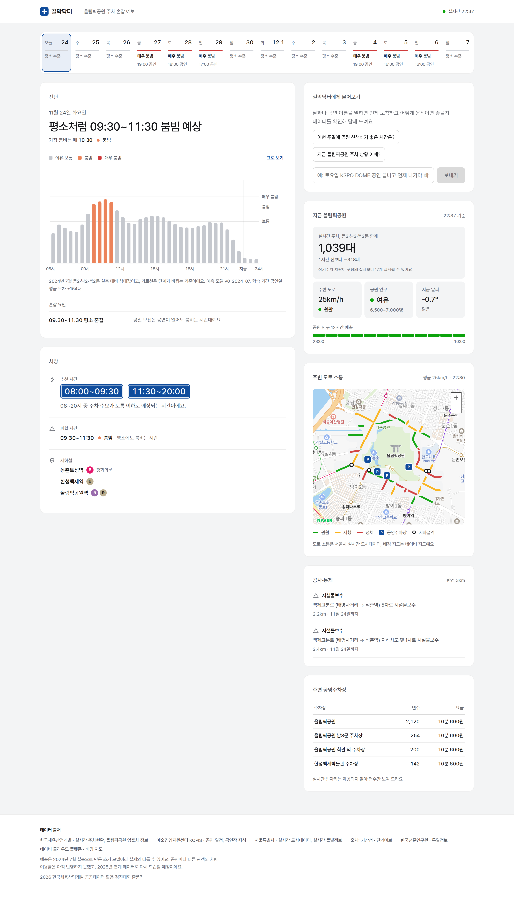
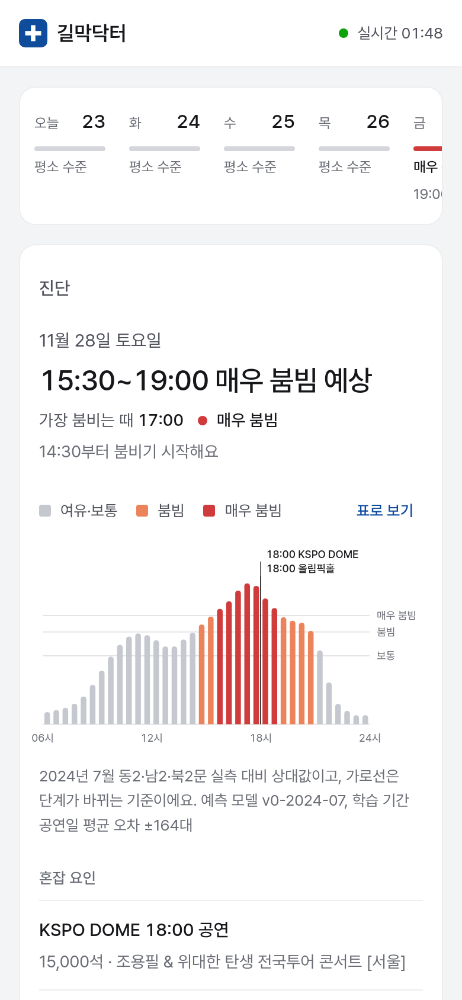

# 길막닥터

공연·행사가 있는 날 올림픽공원 주차 혼잡을 미리 진단하고, 언제 도착하고 어떻게 움직일지 알려 주는 웹서비스입니다.
2026 한국체육산업개발 공공데이터 활용 경진대회 출품을 위해 만들고 있습니다.

## 화면 구성

| 영역 | 내용 |
|---|---|
| 날짜 띠 | 앞으로 2주. 대형 공연이 있는 날만 예상 혼잡 단계를 색으로 표시 |
| 진단 | 선택한 날의 30분 단위 주차 수요 예측, 가장 붐비는 구간, 혼잡 요인(공연·평소 패턴·날씨) |
| 처방 | 공연 관람객: 권장 도착 시각, 공연 후 출차가 몰리는 구간, 지하철. 공원 방문객: 덜 붐비는 시간대, 피할 시간 |
| 지금 올림픽공원 | 실시간 주차대수, 네이버 지도 위 주변 도로 소통, 공원 인구, 날씨, 공사·통제, 주변 공영주차장 |
| 길막닥터에게 물어보기 | 첫 화면 오른쪽 위의 AI 상담. "토요일 KSPO DOME 공연 끝나고 언제 나가야 해?"처럼 물으면 예측·실시간 데이터를 확인해 답하고, 답은 만들어지는 대로 흘러나온다. 화면을 내리거나 좁은 화면에서는 오른쪽 아래 바로가기 버튼으로 연다 |

처방 시각은 도로 안내표지처럼 파란 판에 표시합니다. 날짜는 `?date=YYYY-MM-DD` 로 바로 열 수 있습니다.

## 화면

2026년 11월 23일에 실제 데이터로 찍은 화면입니다. 실시간 값은 찍은 시각 기준입니다.

### 공연이 있는 날

11월 27일(금) 화면입니다. KSPO DOME 19:00 공연과 올림픽홀 20:00 공연 때문에 18:00~21:30이 매우 붐빌 것으로 예측합니다. 처방은 지하철 이용과 22:20 이후 출차입니다.


### 공연이 없는 날과 모바일

<table>
  <tr>
    <th>공연이 없는 평일(11월 23일), 공원 방문 처방</th>
    <th>모바일 첫 화면(11월 28일 공연일)</th>
  </tr>
  <tr>
    <td></td>
    <td></td>
  </tr>
</table>

### 다듬기 전과 후

첫 구현을 unslop 방식으로 다듬었습니다.

- 글자 굵기와 크기 종류를 줄이고 간격을 4px 격자에 맞췄습니다.
- 날짜 띠는 매일 반복되는 혼잡을 회색 "평소 수준"으로 묶고, 공연이 있는 날만 색으로 드러냈습니다.
- 예측 차트를 진단 카드 안으로 옮겨 화면의 중심에 두었습니다.
- 처방 시각은 도로 안내표지 판으로 표시합니다.

<table>
  <tr>
    <th>다듬기 전</th>
    <th>다듬은 뒤</th>
  </tr>
  <tr>
    <td></td>
    <td></td>
  </tr>
</table>

모바일 전체 화면과 다시 찍는 방법은 [docs/README.md](docs/README.md)에 있습니다.

## 사용 데이터

| 기관 | 데이터 | 용도 | 키 |
|---|---|---|---|
| 한국체육산업개발 | 실시간 주차현황 | 현재 주차대수, 실측 이력 수집 | 기관 공개 키 |
| 한국체육산업개발 | 올림픽공원 입출차 정보(2024년 7월) | 예측 모델 v0 학습 | 파일 |
| 예술경영지원센터 | KOPIS 공연목록·공연상세·공연시설 | 공연 일정, 시작 시각, 공연장 좌석 | `KOPIS_API_KEY` |
| 서울특별시 | 실시간 도시데이터(올림픽공원 POI127), 실시간 돌발정보 | 도로 소통, 공원 인구, 공영주차장, 지하철역, 공사·통제 | `SEOUL_API_KEY` |
| 기상청 | 단기예보 | 선택한 날의 날씨 | `DATA_GO_KR_KEY` |
| 한국천문연구원 | 특일정보 | 공휴일 | `DATA_GO_KR_KEY` |
| 네이버 클라우드 플랫폼 | Maps(Dynamic Map) | 도로 소통 지도의 배경 지도 | `NAVER_CLOUD_PLATFORM_CLIENT_ID` |

한국체육산업개발의 2025년 입출차·공연·날씨 연계 데이터(문화공공데이터광장, `CULTURE_API_KEY`)로 모델을 다시 학습할 예정입니다.

## 구성

```
브라우저 ── 화면(React, app/) ──/api──▶ 백엔드(Go + Gin, backend/) ──▶ 공공 API
                                           │  ├─ 실시간 수집기(5분마다 기록)
                                           │  └─ 예측 모델 v0 내장본(AI 서비스가 꺼졌을 때)
                                           ▼
                                  AI 서비스(Python + FastAPI, ai/)
                                     ├─ /ml/forecast   예측 모델 v0
                                     └─ /agent/chat/stream  상담 에이전트(Claude, 도구로 /api 조회, 스트리밍)
```

- API 키는 서버(`backend/`, `ai/`)에만 있고 브라우저로 나가지 않습니다. 네이버 지도 Client ID 만 공개 값이라 `/api/config` 로 내려갑니다.
- 화면은 Go 백엔드 하나만 봅니다. 예측은 Go가 AI 서비스에 맡기고, 상담 요청(`/api/agent/*`)은 Go가 AI 서비스로 그대로 넘깁니다.
- AI 서비스가 꺼져 있어도 화면은 동작합니다. 예측은 Go 내장 모델이 같은 결과를 내고(응답의 `model.source` 가 `embedded`), 상담만 꺼집니다.
- 개발할 때는 Vite가 `/api` 를 Go로 넘기고, 운영할 때는 Go 실행 파일이 빌드된 화면과 API를 함께 서빙합니다.

| API(Go) | 내용 |
|---|---|
| `GET /api/overview?days=14` | 날짜별 가장 붐비는 단계와 대형 공연 |
| `GET /api/day?date=YYYY-MM-DD` | 30분 단위 예측, 공연, 처방, 날씨 |
| `GET /api/live` | 실시간 주차, 도로 소통, 공원 인구, 날씨, 공사·통제, 공영주차장 |
| `GET /api/shows?days=31` | 기간 안 모든 공연 회차(소규모 포함, 상담 에이전트의 공연 검색용) |
| `GET /api/config` | 공개 설정(네이버 지도 Client ID) |
| `GET /api/agent/status`, `POST /api/agent/chat/stream`, `POST /api/agent/chat` | 상담(AI 서비스로 그대로 넘김, 스트리밍은 받는 즉시 흘려보냄) |
| `GET /api/health` | 서버 상태와 키 설정 여부 |

| API(Python) | 내용 |
|---|---|
| `POST /ml/forecast` | 여러 날을 한 번에 예측(날짜 유형, 공연 시작 시각·좌석 수 입력) |
| `GET /ml/model` | 모델 정보와 단계 기준 |
| `POST /agent/chat/stream` | 상담 에이전트. 답을 Server-Sent Events 로 흘려보냄 |
| `GET /agent/status`, `POST /agent/chat` | 상담 에이전트 상태, 답을 한 번에 받기 |

### 상담 에이전트

- Claude API(`claude-sonnet-5-5`, effort `medium`)의 도구 사용으로 동작합니다. 도구는 네 개이고 모두 Go API 를 읽기만 합니다: 2주 일정(`/api/overview`), 날짜별 예측·처방(`/api/day`), 실시간 현황(`/api/live`), 공연 검색(`/api/shows`).
- 대화 기록은 화면이 들고 있다가 매번 보냅니다(서버는 대화를 저장하지 않음). 오늘 날짜와 화면에서 보고 있는 날짜를 맥락으로 함께 보냅니다.
- 화면에서 보고 있는 날짜의 예측과 실시간 현황은 질문과 함께 미리 넣습니다. 대화에 도구 결과가 들어가면 API 가 다음 답을 다 만든 뒤 한꺼번에 보내서(2026년 11월 확인) 글자가 흘러나오지 않기 때문입니다. 대부분의 질문은 도구 없이 바로 흘러나오고, 다른 날짜나 공연이 필요할 때만 도구를 씁니다.
- 스트리밍 이벤트: `tool`(데이터 확인 시작) → `text`(답 글자) → `done`(확인한 데이터 목록). 다시 요청했거나 거절로 끝나면 `reset` 으로 그때까지의 답을 바꾸고, 중간에 실패하면 `error` 로 알립니다. 화면은 한꺼번에 온 글자도 프레임마다 나눠 보여 줍니다.
- 안전 분류기가 요청을 거절하면 같은 호출 안에서 대체 모델로 다시 시도하도록 서버 측 fallback(`fallbacks: "default"`)을 켜 두었습니다.
- `ANTHROPIC_API_KEY` 가 없으면 상담만 꺼지고(503) 나머지 화면은 그대로 동작합니다. 모델과 effort 는 `LLM_MODEL`(기본 `claude-sonnet-5-5`), `LLM_EFFORT`(기본 `medium`, 더 빠른 답이 필요하면 `low`)로 바꿉니다.

## 실행

Go 1.25 이상, Node 20.19 이상, Python 3.11 이상과 [uv](https://docs.astral.sh/uv/)가 필요합니다. 먼저 저장소 루트에서 `cp .env.example .env` 로 키를 채웁니다.

개발할 때는 터미널 세 개를 씁니다.

```bash
# 1) AI 서비스: http://127.0.0.1:8090 (예측 모델, 상담 에이전트)
cd ai
uv run uvicorn app.main:app --host 127.0.0.1 --port 8090

# 2) 백엔드: http://127.0.0.1:8080 (실시간 수집기 포함)
cd backend
go run ./cmd/gilmak

# 3) 화면: http://localhost:5173 (/api 는 백엔드로 넘어감)
cd app
npm install
npm run dev
```

네이버 지도는 콘솔 Maps › Application 의 Web 서비스 URL 에 등록한 도메인에서만 뜹니다. 개발은 `http://localhost` 로 열어야 하고(`127.0.0.1` 은 미등록), 배포할 때 그 도메인을 추가로 등록합니다. 인증에 실패하면 배경 지도 없는 간이 지도로 자동 전환됩니다.

운영 형태로 실행하려면 화면을 빌드한 뒤 백엔드와 AI 서비스를 띄웁니다.

```bash
cd app && npm run build
cd ../backend && go build -o bin/gilmak ./cmd/gilmak
STATIC_DIR=../app/dist PORT=8080 ./bin/gilmak   # http://localhost:8080
cd ../ai && uv run uvicorn app.main:app --host 127.0.0.1 --port 8090
```

| 환경변수 | 기본값 | 설명 |
|---|---|---|
| `PORT` / `ADDR` | `127.0.0.1:8080` | `PORT` 를 주면 `:PORT` 로 듣는다(클라우드 배포) |
| `STATIC_DIR` | 없음 | 빌드된 화면 폴더. 주면 화면까지 서빙 |
| `GILMAK_DATA_DIR` | `data` | 수집 기록(`runtime/`)과 API 캐시(`cache/`) 위치 |
| `GILMAK_COLLECT` | 켜짐 | `0` 이면 실시간 수집기를 끈다 |
| `GIN_MODE` | debug | 운영에서는 `release` |
| `AI_SERVICE_URL` | `http://127.0.0.1:8090` | Go 가 부르는 AI 서비스 |
| `GILMAK_API_URL` | `http://127.0.0.1:8080` | AI 서비스(에이전트 도구)가 부르는 Go API |

수집 기록과 캐시는 `backend/data/` 에 쌓이며 저장소에는 올리지 않습니다. 테스트는 `cd backend && go test ./...`, `cd ai && uv run pytest` 입니다.

## 폴더 구조

```
backend/                  API 서버(Go + Gin)
  cmd/gilmak/             실행 진입점
  internal/api/           핸들러
  internal/sources/       한국체육산업개발, KOPIS, 서울시, 기상청, 특일정보 연동
  internal/ml/            AI 서비스 예측 호출(실패하면 내장 모델)
  internal/model/         처방 계산과 내장 예측 모델(baseline.json, 실행 파일에 포함)
  internal/collector/     실시간 수집기
  internal/types/         API 응답 형태(app/shared/types.ts 와 같아야 함)
  internal/cache, httpx, config, kst, geo
ai/                       AI 서비스(Python + FastAPI)
  app/ml/                 예측 모델 v0
  app/agent/              상담 에이전트(프롬프트, 도구, Tool Runner)
  models/baseline-v0.json 학습 결과
  tests/
app/
  src/                    화면(React)
  shared/types.ts         화면이 받는 API 응답 형태
analysis/                 모델 학습 스크립트(Python)
data/derived/             학습에 쓴 가공 데이터
docs/                     화면 캡처
contest_analysis.md       공모전 요강과 개방 데이터 분석
item_gilmak_doctor.md     아이템 데이터 검증과 계획
```

## 예측 모델 v0

2024년 7월 동2·남2·북2문 입출차 215,528건과 같은 기간 KOPIS 공연 일정으로 만들었습니다.

- 공연이 없는 평일 22일의 평균을 평일 기준선으로 씁니다.
- 7월 주말은 모두 대형 공연일이라, 주말 기준선과 "좌석 1,000석당 공연 영향 곡선"을 공연일 9일에 대해 최소제곱으로 함께 추정합니다.
- 혼잡 단계는 7월 08~23시 분포의 50·80·95분위로 나눕니다(여유·보통·붐빔·매우 붐빔).
- 학습 기간 공연일 평균 오차는 ±164대입니다. KSPO DOME 공연 7회를 실측해 보니 종료 후 출차의 80%가 빠지기까지 걸린 시간의 중앙값은 70분이었습니다.

다시 만들려면 다음을 실행합니다.

```bash
python3 analysis/fetch_kopis_events.py .env 20240701 20240731 data/derived/kopis_events_2024_07.json
python3 analysis/build_baseline.py data/raw/kspo_inout_2024_07/inout_2024_07.csv \
  data/derived/kopis_events_2024_07.json ai/models/baseline-v0.json
cp ai/models/baseline-v0.json backend/internal/model/baseline.json   # Go 내장본도 같은 파일로
```

입출차 CSV는 공공데이터포털 [15138735](https://www.data.go.kr/data/15138735/fileData.do)에서 받습니다.

알려진 한계는 다음과 같습니다.

- 같은 15,000석 공연이라도 관객층에 따라 차량 이용이 크게 다르지만 아직 반영하지 못했습니다. 2024년 7월 실측 피크는 SG워너비 공연일이 2,000대를 넘었고 아이돌 공연일은 1,000대 안팎이었습니다.
- 실시간 주차대수에는 출차 기록이 없는 장기주차 차량이 포함되어 실제보다 많게 집계될 수 있습니다(새벽에도 약 1,000대).
- 서울시 도시데이터의 공영주차장은 면수만 제공되고 실시간 빈자리는 제공되지 않습니다.

## 데이터 출처 표기

한국체육산업개발, 예술경영지원센터 KOPIS, 서울특별시, 기상청(출처: 기상청), 한국천문연구원의 공공데이터를 이용했습니다. 배경 지도는 네이버 지도입니다.
