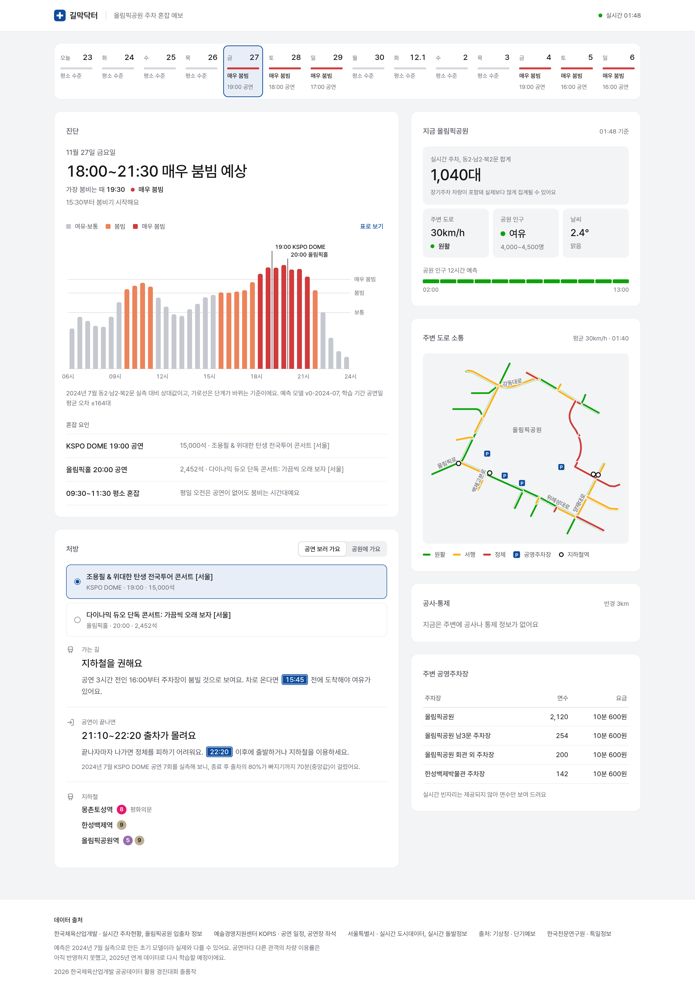
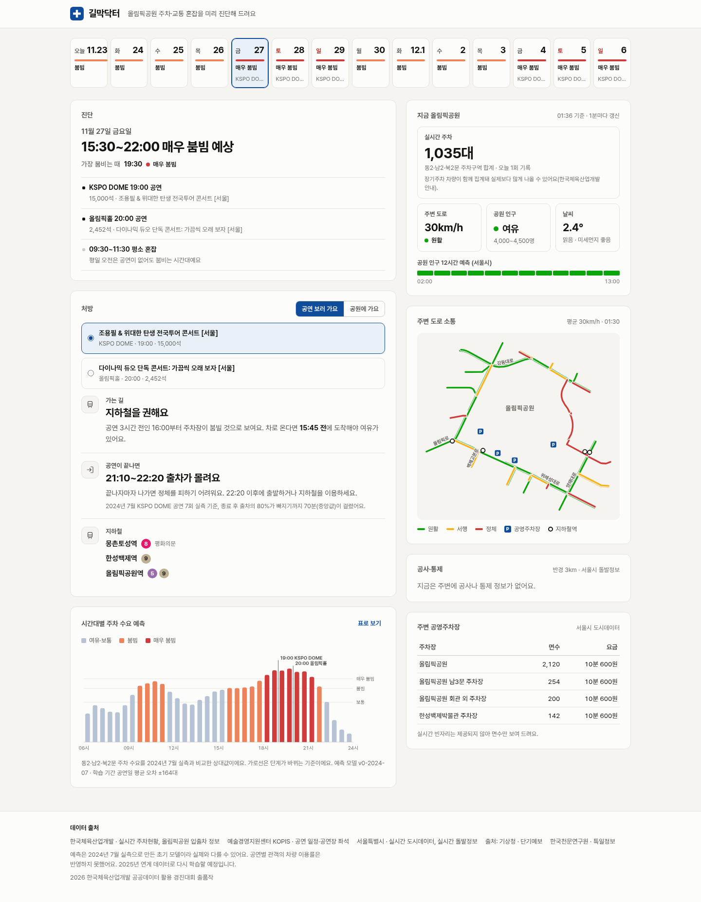

# 길막닥터

공연·행사가 있는 날 올림픽공원 주차 혼잡을 미리 진단하고, 언제 도착하고 어떻게 움직일지 알려 주는 웹서비스입니다.
2026 한국체육산업개발 공공데이터 활용 경진대회 출품을 위해 만들고 있습니다.

## 화면 구성

| 영역 | 내용 |
|---|---|
| 날짜 띠 | 앞으로 2주. 대형 공연이 있는 날만 예상 혼잡 단계를 색으로 표시 |
| 진단 | 선택한 날의 30분 단위 주차 수요 예측, 가장 붐비는 구간, 혼잡 요인(공연·평소 패턴·날씨) |
| 처방 | 공연 관람객: 권장 도착 시각, 공연 후 출차가 몰리는 구간, 지하철. 공원 방문객: 덜 붐비는 시간대, 피할 시간 |
| 지금 올림픽공원 | 실시간 주차대수, 주변 도로 소통 지도, 공원 인구, 날씨, 공사·통제, 주변 공영주차장 |

처방 시각은 도로 안내표지처럼 파란 판에 표시합니다. 날짜는 `?date=YYYY-MM-DD` 로 바로 열 수 있습니다.

## 화면

2026년 11월 23일에 실제 데이터로 찍은 화면입니다. 실시간 값은 찍은 시각 기준입니다.

### 공연이 있는 날

11월 27일(금) 화면입니다. KSPO DOME 19:00 공연과 올림픽홀 20:00 공연 때문에 18:00~21:30이 매우 붐빌 것으로 예측합니다. 처방은 지하철 이용과 22:20 이후 출차입니다.



### 공연이 없는 날과 모바일

<table>
  <tr>
    <th>공연이 없는 평일(11월 23일), 공원 방문 처방</th>
    <th>모바일 첫 화면(11월 28일 공연일)</th>
  </tr>
  <tr>
    <td></td>
    <td></td>
  </tr>
</table>

### 다듬기 전과 후

첫 구현을 unslop 방식으로 다듬었습니다.

- 글자 굵기와 크기 종류를 줄이고 간격을 4px 격자에 맞췄습니다.
- 날짜 띠는 매일 반복되는 혼잡을 회색 "평소 수준"으로 묶고, 공연이 있는 날만 색으로 드러냈습니다.
- 예측 차트를 진단 카드 안으로 옮겨 화면의 중심에 두었습니다.
- 처방 시각은 도로 안내표지 판으로 표시합니다.

<table>
  <tr>
    <th>다듬기 전</th>
    <th>다듬은 뒤</th>
  </tr>
  <tr>
    <td></td>
    <td></td>
  </tr>
</table>

모바일 전체 화면과 다시 찍는 방법은 [docs/README.md](docs/README.md)에 있습니다.

## 사용 데이터

| 기관 | 데이터 | 용도 | 키 |
|---|---|---|---|
| 한국체육산업개발 | 실시간 주차현황 | 현재 주차대수, 실측 이력 수집 | 기관 공개 키 |
| 한국체육산업개발 | 올림픽공원 입출차 정보(2024년 7월) | 예측 모델 v0 학습 | 파일 |
| 예술경영지원센터 | KOPIS 공연목록·공연상세·공연시설 | 공연 일정, 시작 시각, 공연장 좌석 | `KOPIS_API_KEY` |
| 서울특별시 | 실시간 도시데이터(올림픽공원 POI127), 실시간 돌발정보 | 도로 소통, 공원 인구, 공영주차장, 지하철역, 공사·통제 | `SEOUL_API_KEY` |
| 기상청 | 단기예보 | 선택한 날의 날씨 | `DATA_GO_KR_KEY` |
| 한국천문연구원 | 특일정보 | 공휴일 | `DATA_GO_KR_KEY` |

한국체육산업개발의 2025년 입출차·공연·날씨 연계 데이터(문화공공데이터광장, `CULTURE_API_KEY`)로 모델을 다시 학습할 예정입니다.

## 실행

Node 20.19 이상이 필요합니다.

```bash
cp .env.example .env        # 저장소 루트에서, 키를 채운다
cd app
npm install
npm run dev                 # http://localhost:5173 (화면 + /api + 실시간 수집기)
```

- 운영 형태로 실행: `npm run build && npm run serve` (기본 포트 8787)
- 화면 없이 실시간 수집만: `npm run collect`
- 수집 기록과 API 캐시는 `app/data/` 에 쌓이며 저장소에는 올리지 않습니다.

## 폴더 구조

```
app/
  server/            API(Hono): 외부 API 연동, 캐시, 예측 모델, 실시간 수집기
    model/           baseline.json(학습 결과)과 예측·처방 계산
    sources/         한국체육산업개발, KOPIS, 서울시, 기상청, 특일정보
  src/               화면(React)
  shared/            서버와 화면이 함께 쓰는 타입
analysis/            모델 학습 스크립트(Python)
data/derived/        학습에 쓴 가공 데이터
docs/                화면 캡처
contest_analysis.md  공모전 요강과 개방 데이터 분석
item_gilmak_doctor.md 아이템 데이터 검증과 계획
```

## 예측 모델 v0

2024년 7월 동2·남2·북2문 입출차 215,528건과 같은 기간 KOPIS 공연 일정으로 만들었습니다.

- 공연이 없는 평일 22일의 평균을 평일 기준선으로 씁니다.
- 7월 주말은 모두 대형 공연일이라, 주말 기준선과 "좌석 1,000석당 공연 영향 곡선"을 공연일 9일에 대해 최소제곱으로 함께 추정합니다.
- 혼잡 단계는 7월 08~23시 분포의 50·80·95분위로 나눕니다(여유·보통·붐빔·매우 붐빔).
- 학습 기간 공연일 평균 오차는 ±164대입니다. KSPO DOME 공연 7회를 실측해 보니 종료 후 출차의 80%가 빠지기까지 걸린 시간의 중앙값은 70분이었습니다.

다시 만들려면 다음을 실행합니다.

```bash
python3 analysis/fetch_kopis_events.py .env 20240701 20240731 data/derived/kopis_events_2024_07.json
python3 analysis/build_baseline.py data/raw/kspo_inout_2024_07/inout_2024_07.csv \
  data/derived/kopis_events_2024_07.json app/server/model/baseline.json
```

입출차 CSV는 공공데이터포털 [15138735](https://www.data.go.kr/data/15138735/fileData.do)에서 받습니다.

알려진 한계는 다음과 같습니다.

- 같은 15,000석 공연이라도 관객층에 따라 차량 이용이 크게 다르지만 아직 반영하지 못했습니다. 2024년 7월 실측 피크는 SG워너비 공연일이 2,000대를 넘었고 아이돌 공연일은 1,000대 안팎이었습니다.
- 실시간 주차대수에는 출차 기록이 없는 장기주차 차량이 포함되어 실제보다 많게 집계될 수 있습니다(새벽에도 약 1,000대).
- 서울시 도시데이터의 공영주차장은 면수만 제공되고 실시간 빈자리는 제공되지 않습니다.

## 데이터 출처 표기

한국체육산업개발, 예술경영지원센터 KOPIS, 서울특별시, 기상청(출처: 기상청), 한국천문연구원의 공공데이터를 이용했습니다.
