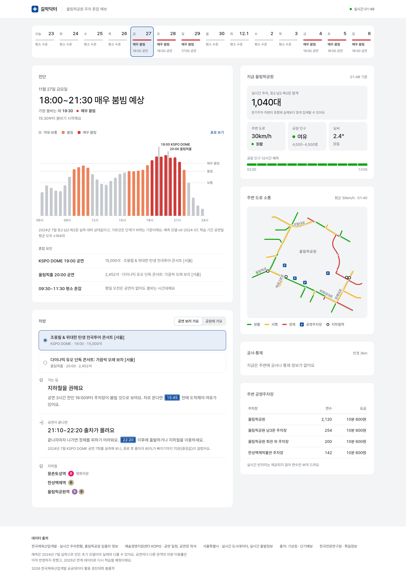

# 문서

## 화면 캡처

2026-11-23 01시 48분에 실제 데이터로 찍은 화면입니다. 실시간 값(주차대수, 도로 소통 등)은 찍은 시각 기준입니다.
2배 해상도(데스크톱 폭 2880px, 모바일 폭 780px)라 기획서에 그대로 넣어도 됩니다.

| 파일 | 화면 |
|---|---|
| [desktop-concert-day.png](screenshots/desktop-concert-day.png) | 데스크톱, 11월 27일(금) 공연일. KSPO DOME 19:00 공연과 올림픽홀 20:00 공연으로 18:00~21:30 매우 붐빔 예상. 처방은 지하철 권장, 차로 온다면 15:45 전 도착, 22:20 이후 출차 |
| [desktop-today.png](screenshots/desktop-today.png) | 데스크톱, 공연이 없는 평일(11월 23일). 공원 방문 처방으로 추천 시간 08:00~09:30, 11:30~20:00 |
| [mobile-concert-day.png](screenshots/mobile-concert-day.png) | 모바일(폭 390px), 11월 28일(토) 공연일 전체. 소규모 공연은 접힌 상태 |
| [mobile-concert-day-top.png](screenshots/mobile-concert-day-top.png) | 위 모바일 화면의 첫 화면만 자른 것(README용) |
| [before-unslop-desktop.png](screenshots/before-unslop-desktop.png) | unslop으로 다듬기 전 첫 구현(비교용, 1배 해상도) |



## 다시 찍는 방법

AI 서비스, 백엔드, 화면 개발 서버를 띄운 상태(실행 방법은 루트 README)에서 헤드리스 Chrome으로 찍습니다. 네이버 지도는 등록된 도메인에서만 뜨므로 `127.0.0.1` 이 아니라 `localhost` 로 엽니다. 날짜는 `?date=YYYY-MM-DD` 로 고릅니다.

```bash
google-chrome --headless=new --hide-scrollbars --force-device-scale-factor=2 \
  --window-size=1440,2500 --virtual-time-budget=20000 \
  --screenshot=docs/screenshots/desktop-concert-day.png \
  "http://localhost:5173/?date=2026-11-27"
```

창 높이를 페이지보다 넉넉하게 잡아야 아래가 잘리지 않습니다. 남는 빈 영역은 이미지 편집기로 잘라 냅니다.
